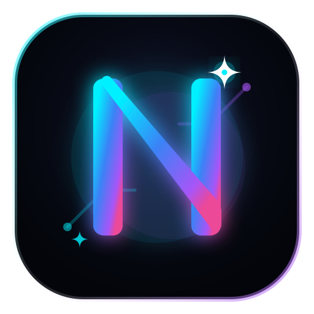

# ⚡ NeuroOS | Autonomous In-Browser AI Operating System

<p align="center">
  
</p>

<p align="center">
  <b>Type your idea. Watch it run live in 5 seconds.</b><br/>
  An autonomous, zero-setup AI operating system simulated directly inside your browser.
</p>

<p align="center">
  
  
  
  
</p>

---

## 🚀 Overview

Unlike traditional AI chat interfaces that dump raw, non-executable code blocks onto your screen, **NeuroOS** operates as a complete browser-native operating system. Powered by **OmniAI**, it autonomously plans architecture, generates clean React components, saves code to an in-browser virtual filesystem (IndexedDB), and executes interactive apps live in an isolated sandbox runner.

---

## ✨ Key Features

- 🧠 **OmniAI Super-Agent**: Single unified agent capable of researching, architecting, and writing full React applications.
- ⚡ **1-Click Instant App Presets**: Zero-friction demo launcher (Glassmorphism Calculator, Cyberpunk Tic-Tac-Toe, Dynamic Weather Widget, Pomodoro Focus Timer).
- 📦 **In-Browser Virtual Disk (VFS)**: Persistent IndexedDB filesystem (`/home`) with upload/download, project exports, and Monaco editor integration.
- 🎮 **Live Interactive Sandbox Runner**: Real-time component mount engine with console logs, responsive viewport switchers (Desktop, Tablet, Mobile), and **1-Click HTML export**.
- ⌨️ **Raycast Command Palette (`⌘K` / `Ctrl + K`)**: Global spotlight search to launch tools, run presets, toggle themes, and export workspaces.
- 🌓 **Adaptive Light & Dark Modes**: Apple Vision-inspired light theme and cyber dark matrix with 100% accessible contrast.
- 🔊 **Zero-Dependency Web Audio FX**: Crisp mechanical clicks, compile chimes, and modal pop sounds built on the native Web Audio API.

---

## 🛠️ Tech Stack

- **Framework**: React 19 + Vite
- **Styling**: Tailwind CSS + Custom Apple Vision Glassmorphic design tokens
- **Window Management**: Custom dnd-kit draggable & resizable window manager
- **3D Graphics**: Three.js + React Three Fiber (Dynamic neural particle mesh)
- **Persistence**: LocalForage (IndexedDB virtual storage)
- **AI Engine**: Google Gemini API (with high-fidelity offline fallback)

---

## 💻 Getting Started

### 1. Clone the repository
```bash
git clone https://github.com/your-username/NeuroOS.git
cd NeuroOS
```

### 2. Install dependencies
```bash
npm install
```

### 3. Start development server
```bash
npm run dev
```

### 4. Build for production
```bash
npm run build
```

---

## 🎯 Keyboard Shortcuts

| Shortcut | Action |
| :--- | :--- |
| `Ctrl + K` / `Cmd + K` | Open Raycast Command Palette |
| `Ctrl + T` | Open Terminal |
| `Alt + Tab` | Cycle through active windows |
| `Esc` | Close focused window |

---

## 📄 License

Distributed under the MIT License. Built with ❤️ for the future of in-browser AI tooling.
